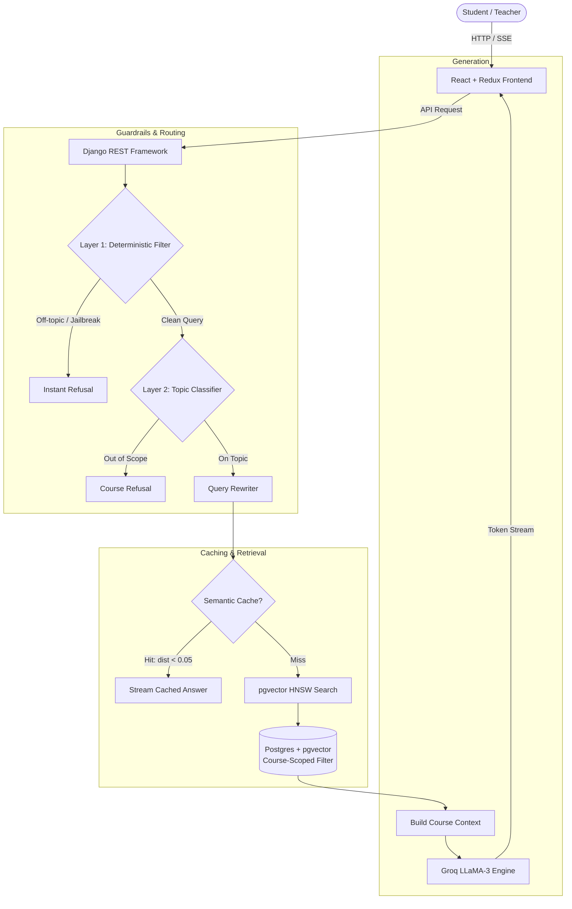

# Scholaria 🎓


Scholaria is a modern, full-stack Learning Management System (LMS) built with a Robust and multi-tenant **Retrieval-Augmented Generation (RAG)** pipeline. It features an AI learning companion, **Edah**, that delivers context-aware, course-scoped tutoring based on the materials students are actively enrolled in.

---

## Architecture Overview



---

## Core Features

### Role-Based Access Control (RBAC)
- **Teachers**: Manage courses, modules, lessons, quizzes, and assignments. AI interactions are restricted to their taught curriculum.
- **Students**: Enroll in courses, complete lessons, submit assignments, and take quizzes. AI tutoring is scoped strictly to their enrolled courses.
- **Admins**: Platform oversight and system administration.

### AI Learning Companion (RAG Pipeline)
- **Two-Tier Ingestion Architecture**:
  - *Cold-Start / Bulk Ingestion*: The `python manage.py ingest_all_data` command iterates over all `RAGSearchableMixin` models (`Lesson`, `Quiz`, `Question`, `Assignment`) to chunk and embed existing content into `DocumentChunk` table.
  - *Real-Time Incremental Sync*: Django `post_save` signals automatically dispatch background Celery tasks (`ingest_searchable_object_task`) to re-chunk and embed content whenever lessons, quizzes, or assignments are created or updated.
- **PostgreSQL Vector Retrieval**: Uses PostgreSQL with `pgvector` and HNSW indexing for scalable, low-latency cosine distance vector similarity search.
- **Database-Level Multi-Tenancy**: Vector retrieval strictly filters candidate chunks by the student's enrolled `course_id`s at the database level, preventing cross-course data leakage.
- **Dual-Mode Response Generation**:
  - *Grounded Mode*: Prioritizes retrieved course materials and cites specific lessons.
  - *Controlled Fallback*: When course materials do not fully cover a concept, explicitly disclaims that the topic is outside the syllabus and supplements with general academic knowledge within the enrolled course scope.
- **Multi-Layer Guardrails & Performance**:
  - *Layer 1 (Regex)*: Sub-millisecond deterministic keyword pre-filter to reject off-topic queries and prompt injections instantly without API costs.
  - *Layer 2 (LLM Classifier)*: Course-scoped binary classification that fails open during transient API degradations to maintain platform availability.
  - *Semantic Caching*: Caches query embeddings in `pgvector` (cosine distance threshold < 0.05) to eliminate LLM latency and token costs on repeated questions.

---

## Tech Stack

* **Backend**: Django 4.2, Django REST Framework, Gunicorn, Celery, Redis
* **Vector Database**: PostgreSQL 16 + `pgvector` (HNSW indexing)
* **Embedding Model**: `sentence-transformers` (`all-MiniLM-L6-v2`, 384 dimensions)
* **LLM Engine**: Groq API (LLaMA 3) with Server-Sent Events (SSE) streaming
* **Frontend**: React 18, Vite, Redux Toolkit, React Router v6
* **Package Management & Tooling**: `uv`, Docker, Docker Compose

---

## Local Setup & Installation

### Prerequisites
- [Docker](https://docs.docker.com/get-docker/) & Docker Compose
- A [Groq API Key](https://console.groq.com/) for AI inference

### 1. Clone the repository
```bash
git clone https://github.com/mpyth0nist/scholaria.git
cd scholaria
```

### 2. Configure Environment Variables
Copy the example environment file and add your Groq API key:
```bash
cp .env.example .env
```
*(The default database credentials in `.env.example` work out of the box with Docker Compose. Add your `GROQ_API_KEY` in `.env`).*

### 3. Start Services with Docker Compose
Start all containers in detached mode:
```bash
docker compose up -d --build
```
*(To follow logs at any time, run: `docker compose logs -f`)*

### 4. Database Setup & Seeding (Initial Run)
Apply database migrations, optionally seed demo courses and quizzes, and create an administrator account:
```bash
# 1. Apply database migrations
docker compose exec backend uv run manage.py migrate

# 2. Seed demo university courses, student account, quiz, and vector embeddings
docker compose exec backend uv run python scripts/seed_demo.py

# 3. (Optional) Create an administrator account
docker compose exec backend uv run manage.py createsuperuser
```

#### Demo Credentials (Created by `seed_demo.py`):
| Role | Username | Password | Enrolled Courses |
| :--- | :--- | :--- | :--- |
| **Student** | `sarah_chen` | `student123` | 3 University Courses (CS, Microeconomics, History) |
| **Teacher** | `youssef_kaddioui` | `yousef1234` | Course Creator & Manager |


### 5. RAG Vector Ingestion (Cold Start vs. Runtime)

The RAG pipeline operates in two modes:

#### A. Initial Batch Ingestion (Cold Start)
If you have existing database records (from custom seeds, migrations, or data dumps) that have not yet been indexed into `pgvector`, run:
```bash
docker compose exec backend uv run manage.py ingest_all_data
```
> **When is `ingest_all_data` required?**
> - **Initial Setup / Post-Seed**: Signals only react to *future* saves. Any existing records in the database must be indexed once via this batch command.
> - **Switching Embedding Models**: If you change `RAG_EMBEDDING_MODEL` in settings (e.g., changing from `all-MiniLM-L6-v2` to another model), old vectors are incompatible and the index must be rebuilt.
> - **Chunking Strategy Changes**: If you update `CHUNK_THRESHOLD`, `chunk_size`, or `overlap` in `utils/chunking.py`.
> - **Reconciliation**: If the Celery worker or Redis broker was temporarily down and some real-time updates were missed.

#### B. Real-Time Incremental Sync (Runtime)
In day-to-day use, you **do not** need to run `ingest_all_data`. Whenever a teacher creates or updates a lesson, quiz, or assignment via the platform, Django `post_save` signals automatically dispatch a background Celery task (`ingest_searchable_object_task`) to re-chunk and embed the content dynamically.

Start the Celery worker to process these background ingestion tasks:
```bash
docker compose exec -d backend uv run celery -A scholaria worker -l info
```

---

### 6. Access the Platform
* **Frontend**: [http://localhost](http://localhost)
* **Backend API**: [http://localhost:8000/api/](http://localhost:8000/api/)
* **Django Admin**: [http://localhost:8000/admin/](http://localhost:8000/admin/)
* **Silk Performance Profiler**: [http://localhost:8000/silk/](http://localhost:8000/silk/)

### 7. Seed a Teacher Dashboard Demo
The demo seeder uses the existing Django models and requires an existing teacher account. Run it from the repository root against the intended demo database:
```bash
ALLOW_DEMO_SEEDING=1 DEMO_PASSWORD='choose-a-demo-password' \
  uv run python scripts/seed_demo.py --teacher youssef_kaddioui --anchor-date 2026-10-11
```

Use the same `--anchor-date` and `--seed` values on reruns; generated quiz attempts then reuse their stable timestamps. The script does not reset or delete data. It expects the teacher to have no courses/quizzes yet, or only the two demo courses and quizzes. It aborts if those assumptions or the reserved demo student identities conflict with existing data. `DEMO_PASSWORD` is applied only to newly created demo students.

---

## 🧪 Testing

The test suite covers the RAG utility layer, document ingestion idempotency, LLM mocking, and role-based API scoping.

### Run tests inside the backend container:
```bash
docker compose exec backend uv run pytest
```

### Or run tests natively on your host:
```bash
# Ensure PostgreSQL & Redis containers are running
docker compose up -d postgres redis

# Run test suite using uv
uv run pytest
```
